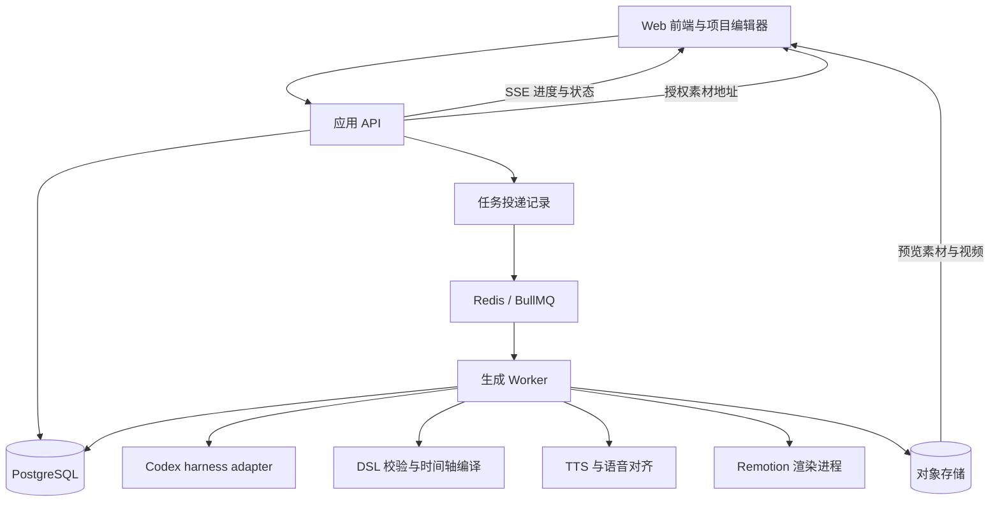

# OpenTutor 技术方案

版本：v0.5  
日期：2026-10-10  
状态：首版实现与链路验证已完成，完整性能和内容质量验收待完成  
配套文档：[产品需求](./product-requirements.md)

实施说明：首版代码和链路验证已落地，实际能力与剩余范围见[实现状态](./implementation-status.md)；本文保留完整目标方案，不代表所有部署与质量机制已实现。

工作台采用[章节内容编辑设计](./workbench-design.md)。主流程只有 `preview`（编排、配音、可播放预览）与 `export`（下载前编码）；底层 `compose`、`speech`、局部重生成等接口继续兼容。增量 `job.preview` 绑定输入版本，未完成真实配音的预览不能导出。

## 通用视频表达（v0.5）

- `Settings.videoIntent` 默认为 `auto`，预设 `explainer`、`product`、`briefing`、`story`；`creativeBrief` 为可选自由文本，表达预设之外的意图、语气、结构与节奏。新建项目受众默认为普通观众，已有受众保留。预设只提供编排方向，不限制内容类型。
- 导演、全项目概览、分批编排、修复与局部重生成共用用途和创作要求。模型按素材选择结构，不强制非教学内容输出课堂开场、学习目标或知识测验。图片分析只报告可见事实，导演再结合用途安排展示、说明或叙事，不能凭用途编造数据、引语或产品能力。
- 自定义 SVG 可以静态展示，也可以服务信息变化、叙事、情绪和构图；运动需要明确作用，禁止反复添加无意义匿名小球。代码执行、来源覆盖、图片引用与字幕／配音约束继续适用。
- 内部 `Lesson`、`objectives`、`chapterId` 等结构与现有 API 保留兼容；`objectives` 表达视频的沟通目标，不意味着必须出现“学习目标”场景。项目按章节组织，每章仍独立输出一个视频。
- 用途和创作要求参与编排缓存；提示词版本变化使后续生成采用新策略。章节输入指纹只在新参数非默认时加入字段，保持旧版默认指纹不变。读入旧项目、章节设置及任务快照时补默认，不重写历史；用户实际改变用途或创作要求才使本章视频过期。

## 章节生成与模式扩展（v0.4）

- `Chapter.settings` 保存章节参数，未设置时继承项目默认；新增 `model`、`creationMode` 和 `stylePrompt`。章节任务带 `chapterId`，输入快照只编排目标章节，`context` 保留全项目关系。
- `Project.chapterVideos[chapterId]` 独立保存 lesson、renderPlan、previewAssets、settings、sourceKey 和 latestExport。sourceKey 基于本章正文、标题、参数、引用素材实际哈希及继承图片定义；无关章修改不影响本章输出。导出使用对应章节冻结预览，不能串用整项目或其他章节音轨。
- 模型目录经 Codex app-server `initialize` / `model/list` 获取，有限缓存和超时；选择的模型传入图片理解、全项目概览、编排与修复，并进入缓存指纹。目录不等于账号授权验证。[官方模型目录说明](https://developers.openai.com/siwc/token-sharing-open-source/codex-app-server)
- 稳定模式的生成 schema 排除 `custom`，校验也禁止自定义对象。创作模式允许 `custom.content` 保存最多 12000 字符 JavaScript 函数体，使用 frame/fps/width/height/progress/theme 返回 SVG。
- 创作模式允许静态图解；动态应表达具体实体、关系或状态变化，例如求值替换、绑定连线和步骤高亮。提示词禁止无语义的移动小球、绕圈及进度装饰，要求过程结束后保留结果；真实物体运动或有明确身份的数据流仍可使用圆形。这是生成质量约束，不是禁止 `circle` 标签的运行时规则，也不是已实现的自动内容质量评审。规则升级进入编排缓存版本，已发布视频保留，重新生成时采用新规则。
- 自定义组件在 QuickJS WebAssembly 内执行，不注入宿主能力，每帧独立环境，8 MiB 内存、256 KiB 栈、40 ms 截止与指令中断上限。输出经过 SVG 元素／属性白名单，不允许脚本、外链、DOM、CSS/SMIL 动画；每个 SVG 最多 100000 字符、2000 节点。生成时多帧执行校验，预览与导出共用执行器，错误不会作为正常成片静默导出。[QuickJS 官方项目](https://github.com/justjake/quickjs-emscripten)
- AI 输出的 `Lesson.palette` 传入 RenderPlan，包含 background/surface/text/muted/accent；四个模板提供默认值，最终渲染检查文本对比度。组件库使用相同 LessonVideo 渲染器展示全部现有组件与布局。

### 长章节编排

章节独立生成不意味着整章单次调用模型。编排器按正文长度与来源块数分批，创作模式使用更小预算；全项目概要与邻接上下文保持紧凑，正文只在目标批中完整输入。一个场景可引用多个相邻来源块，每批有独立场景数量上限，逐批检查完整来源覆盖后发布增量预览。

单次模型超时与用户取消分开处理。仅超时会拆小失败批次，并保存拆分树；重试沿同一拆分树复用已校验结果。缓存绑定来源片段、模型、推理强度、风格和上下文，不绑定动态进度序号。图片节点记录原始 UTF-16 范围，长块切开后图片只交给对应片段。明确的整任务时限和最大拆分深度避免无限重试。

引擎显式使用 `medium` 推理强度，可由 `CODEX_REASONING_EFFORT` 覆盖，不继承桌面 Codex 的 `ultra` 配置；此项进入生成缓存指纹。

## 1. 已确认的设计边界

- 产品是完整的 Web 前后端应用，支持在浏览器中导入文稿、生成、预览、编辑和导出。
- 输入面向任何适合图文、图解、旁白与字幕表达的 Markdown 内容，覆盖产品、汇报、故事、知识讲解及其他用途，不要求特定模板。
- “生成视频”端到端完成图片理解、内容规划、讲稿、DSL、配音和可播放时间轴；只有下载时生成 MP4。
- 初版不包含 VTuber、数字人、角色口型或动作系统。
- Codex harness 是后端 AI 执行引擎，负责规划、DSL 生成和诊断修复等任务。
- 首版 TTS 使用微软免费语音服务，按 Microsoft Edge 在线朗读服务与 `edge-tts` 接入方案实现。
- 通用视频场景提供基础覆盖，专门场景逐步提高演示能力；回退不得静默删掉内容要点。

以下技术栈、接口、数据模型和数值默认值均为建议方案。微软免费 TTS 已确定，具体接入按 Edge 朗读服务设计；部署形态、账号体系和资源限额仍可调整，不把其他建议视为用户已确认的要求。

## 2. 总体架构

采用 Web/API、后台 Worker、持久化基础设施三部分。首版 API 可以与 Next.js Web 同仓部署，生成和渲染必须在独立 Worker 中运行。



### 2.1 服务职责

| 部分 | 职责 | 不承担的工作 |
| --- | --- | --- |
| Web | 导入、设置、任务进度、场景编辑、播放器、导出 | 直接调用模型或持有后端凭证 |
| API | 身份与项目访问、项目版本、任务提交、取消、重试、工件授权 | 在 HTTP 请求内运行完整生成或视频渲染 |
| Worker | 执行生成流水线、检查修复、缓存、配音、渲染、登记结果 | 把模型的自述当作完成事实 |
| PostgreSQL | 项目、版本、任务、步骤、事件与工件清单的事实来源 | 存放大体积音视频二进制 |
| Redis / BullMQ | 队列投递、并发调度、临时通知 | 替代数据库中的业务状态 |
| 对象存储 | 原始素材、音频、DSL、预览帧、中间结果、成片 | 无授权公开所有项目文件 |

### 2.2 建议技术栈

| 层 | 建议选型 | 理由 |
| --- | --- | --- |
| 前端与 API | Next.js、React、TypeScript | 一套工程提供制作界面和服务入口 |
| 后台任务 | Node.js / TypeScript Worker、BullMQ | 长任务独立于页面与请求生命周期 |
| 数据库 | PostgreSQL；ORM 在实现前确定 | 支持版本、事务、任务提交条件检查 |
| AI 引擎 | `@openai/codex-sdk` 的后端适配层 | 使用 Codex 的代理执行能力 |
| 配音 | Microsoft Edge 在线 TTS；Python `edge-tts` 适配器 | 接入微软免费朗读服务，无需 TTS API key；由后台 Worker 调用 |
| 文档解析 | remark / mdast，GFM 与数学语法扩展 | 保留文档结构与源位置 |
| Schema | Zod 与生成的 JSON Schema | 统一服务端、编辑器和生成工件契约 |
| 预览与导出 | `@remotion/player`、Remotion Renderer、FFmpeg | 共用场景实现与编译后的输入 |
| 文件存储 | S3 兼容接口；开发环境使用本地兼容实现 | 持久化工件，避免依赖 Worker 本地磁盘 |
| 状态推送 | SSE，轮询作为恢复方式 | 生成进度主要是服务端到客户端的单向更新 |

具体版本在首次实现时锁定。浏览器、字体、组件、编译器和编码配置都需要记录版本，以支持同一工件在固定环境中重现。

## 3. 核心数据流与表示

```text
Chapters + Markdown + assets
    → SourceDocument + ImageAnalysis
    → LessonPlan
    → Video DSL
    → 校验与场景预检
    → TTS + Alignment
    → RenderPlan
    → Remotion Player 交互预览 + 字幕
    → 用户点击下载
    → MP4 编码
```

### 3.1 SourceDocument：原始内容索引

解析器保存原始文本、内容哈希、章节树、块类型、源位置和资源映射。块类型至少覆盖标题、段落、列表、引用、表格、图片、代码块、公式与链接。

- 为每个块分配稳定 `blockId`，源引用绑定具体 `sourceRevisionId`。
- 文本范围使用明确的偏移单位，建议采用 JavaScript UTF-16 code unit 的半开区间，并保存行列位置；对齐供应商的偏移须转换到统一单位。
- 相对图片路径通过本次上传的素材清单解析，不能默认读取服务器任意文件。
- 不识别的代码语言仍能作为代码显示；代码块默认是展示内容，不自动执行。
- Markdown 中的 HTML 采用清理后呈现或文字回退，不执行脚本。
- 原始链接作为引用保留，不默认把网页内容并入项目。当前不下载远程图片，需作者上传；缺失素材产生可定位诊断。

### 3.1.1 章节作为源数据

`ProjectSnapshot` 增加 `chapters: {id,title,markdown}[]` 和 `sourceMode`。新项目以章节为源，聚合 Markdown 供兼容接口使用；章节的 ID、标题、顺序与正文全部参与失效判断。旧数据保持 `legacy` 模式，读取时适配章节列表但不改变原有内容块 ID 和已生成视频，作者保存章节修改后才切换。

源索引记录稳定章节 ID、正文块和 `imageOccurrences`。每个图片引用包含素材 ID、来源块、章节、alt 与相邻说明；重复引用分别保留。`asset://UUID` 为首选语法，旧文件名仅唯一匹配时可用。空章保存合法，编排跳过并提示；没有可呈现正文时阻止生成。

### 3.1.2 真实图像输入与图片理解

1. 上传时校验 PNG/JPEG/WebP 格式和尺寸，登记内容哈希、宽高和受保护的素材 ID。只使用注册文件，不跟随文稿中的服务器路径。
2. Worker 读取实际文件并计算哈希，校验素材所属。将 EXIF 方向统一、按上限等比缩放后转换为 PNG，供 Codex 视觉输入使用。
3. Codex SDK 接收 `local_image` 输入，临时只读目录中仅放置本次图片副本。图片内容、alt 与文件名均作为数据，不作为指令；不允许文稿触发 shell、MCP 或外部工具。
4. 分析结果包含类型、可见内容、可读文字、不确定项和原图归一化区域坐标。按实际字节哈希、模型配置和分析版本缓存，不能仅靠文件名判断已分析。
5. 全项目规划建立章节关系；逐章生成携带整章正文、全项目上下文、相关图片分析和实际图片输入。避免把标题单独当作一章生成无意义解释。
6. 图片对象引用素材 ID，可附 `imagePresentation: {fit:"contain", caption, region, highlight}`。区域都以原图的 `[0,1]` 坐标表达，渲染时换算裁剪与留白；不使用网页容器坐标。
7. 区域必须有效且匹配图片识别结果；不确定时回退全图并记录诊断。每个引用必须被关联来源的场景采用，并在讲稿期间显示；遗漏触发有限修复。

图片理解能力参考 [Codex 图像输入文档](https://learn.chatgpt.com/docs/image-inputs)；具体调用按已安装 SDK 类型实现。程序可检查引用、区域边界和显示时机，不能把结构通过等同于视觉事实全部正确。

### 3.2 LessonPlan：视频内容语义

LessonPlan 保存项目标题、受众、目标、章节、术语、内容单元、示例和来源关系。先建立全局大纲，再分章节规划，避免长文的各部分独立生成后失去依赖关系。

- 每个内容单元声明 `sourceRefs`、表达意图和关联场景。
- 表达意图可为引入、介绍、对比、论述、叙事、演示、收束等，按素材与作者要求选择。
- 完整模式维护内容覆盖清单；正文事实、事件、观点、例子和必要限定条件需有对应输出，重复内容可以合并但要保留映射。
- 摘要模式显式记录合并与省略项；不能为满足默认时长自动切换摘要。
- AI 补充的类比或解释记录为补充内容，不能伪造为原文事实。
- 目标时长与完整覆盖冲突时，返回可理解的取舍信息；长文可以按章节生成和导出。

### 3.3 Video DSL：可编辑场景

DSL 保存对象、布局约束、显示状态、讲稿、语义事件和来源。Agent 生成候选 DSL，服务端验证、汇总后创建新的项目结果版本；不向已有不可变输入版本补写计划或 DSL。

核心内容类型建议包括 `text`、`image`、`formula`、`code`、`table`、`diagram`。动作包括显示、聚焦、逐项揭示、标注、替换和转场。专门场景通过命名空间扩展，如 `cs.callStack`，不要求核心 Schema 理解所有学科。

下面是概念性场景示例，用于说明契约方向，不是已经实现的 Schema：

```json
{
  "schemaVersion": "0.1",
  "sceneId": "scene_expression",
  "sourceRefs": [{ "blockId": "block_3", "sourceRevisionId": "src_1" }],
  "layout": { "preset": "content-focus" },
  "objects": [
    { "id": "expr", "type": "code", "language": "python", "content": "1 + 2 * 3" }
  ],
  "narration": [
    {
      "id": "utterance_1",
      "text": "乘法的优先级高于加法，所以先计算二乘三。",
      "anchors": [{ "id": "multiply", "phrase": "先计算二乘三", "occurrence": 1 }]
    }
  ],
  "events": [
    {
      "id": "focus_multiply",
      "when": { "utteranceId": "utterance_1", "anchorId": "multiply", "edge": "start" },
      "action": "focus",
      "target": { "objectId": "expr", "range": [4, 9] }
    }
  ]
}
```

在该代码快照中，`[4, 9)` 指向 `2 * 3`；讲稿锚点先在规范化文字中解析为唯一范围，再映射到音频。重复短语必须指定出现位置。代码变化后重新验证范围；具备解析能力的专门场景优先使用 token/AST 节点或经过验证的步骤快照。

### 3.4 RenderPlan：冻结后的执行输入

RenderPlan 只包含已解决的布局、素材、音频、字幕、帧时间和动画曲线。渲染阶段不调用模型，也不临时生成素材。

- 记录父项目版本、DSL 哈希、音频哈希、对齐器和编译器版本。
- 固定 `fps`、分辨率、字体、主题、场景顺序和随机种子。
- 对象 ID、事件 ID 和来源映射延续到渲染工件与诊断中。
- 未解析资源、事件锚点或跨版本工件均拒绝进入最终渲染。
- 素材使用稳定资产 ID 与内容哈希；临时签名 URL 在读取时解析，不作为内容哈希的一部分。

## 4. Codex harness 接入

### 4.1 接入决策

首版建议由 Worker 使用官方 TypeScript Codex SDK。SDK 支持启动、继续和恢复本地代理线程，适合服务端程序化任务。[官方 SDK 文档](https://learn.chatgpt.com/docs/codex-sdk)

先封装 OpenTutor 自己的 `AgentEngine`，避免业务依赖具体 SDK 的事件和参数。`codex exec` 可以作为内部验证或适配路径，它支持 JSONL 事件及 JSON Schema 约束最终响应。[官方非交互调用文档](https://learn.chatgpt.com/docs/non-interactive-mode)

以后若产品需要持续对话、审批或更深入的客户端控制，再评估 App Server；当前官方文档对其命令和 WebSocket 传输标有实验性与生产限制，初版不以该接口作为必要条件。[App Server 文档](https://learn.chatgpt.com/docs/app-server)

Harness 的开源组件与模型访问、托管服务是不同层。开发机已有 Codex 可执行文件并不证明服务部署时具备凭证、额度或模型访问；认证和部署时需单独验证。[官方平台说明](https://developers.openai.com/blog/codex-as-a-platform)

### 4.2 应用接口

以下为应用自定义接口示意，不是 Codex SDK 原生 API：

```ts
type AgentTaskKind = 'plan' | 'compose' | 'repair' | 'review';

interface AgentTaskRequest {
  kind: AgentTaskKind;
  generationId: string;
  inputRevisionId: string;
  candidateRevisionId?: string;
  sceneId?: string;
  inputArtifactIds: string[];
  outputSchemaId: string;
  capabilityVersion: string;
  limits: { timeoutMs: number; maxRepairAttempts: number };
}

interface AgentTaskResult {
  candidateArtifactIds: string[];
  diagnostics: Diagnostic[];
  sessionId?: string;
  usage?: { inputTokens?: number; outputTokens?: number };
}

interface AgentEngine {
  run(task: AgentTaskRequest, signal: AbortSignal): Promise<AgentTaskResult>;
}
```

Adapter 管理独立工作区、代理会话、事件转换、工件读取和进程生命周期。`inputRevisionId` 指本次调用的冻结输入；基于已有候选修复时，另记录 `candidateRevisionId`。应用级取消信号由 Adapter 转换为当前固定版本支持的中断或进程终止机制，接入验证需确认子进程也能结束。

### 4.3 任务与工具

| 任务 | 输入 | 输出 |
| --- | --- | --- |
| 内容规划 | 原文索引、目标、受众、覆盖模式 | LessonPlan 候选 |
| 场景生成 | 内容单元、讲稿、组件能力清单与示例 | Video DSL 候选 |
| 诊断修复 | 原候选、来源、结构化诊断、必要预览帧 | 受影响场景的候选版本 |
| 内容与画面审查 | 原文、计划、关键帧、规则检查结果 | 审查报告与修改建议 |

向 Agent 提供项目专用的受限命令或 MCP 工具：组件能力查询、来源读取、DSL 校验、场景预览、布局检测、受支持示例验证。每个工具验证任务身份、作用域和输入 Schema。Agent 不能直接更新数据库的完成状态或修改共享渲染器源码。

系统提示与版本化指令定义视频表达策略；Markdown 作为资料输入，不作为运行指令。每个项目任务有主会话，场景并发任务使用独立会话和目录。业务恢复依赖已保存的工件，不只依赖聊天历史。

### 4.4 有限修复

1. 生成候选工件并保存。
2. 程序执行结构、引用、布局及相关语义检查。
3. 将可定位诊断和必要预览帧交给 Codex 修复。
4. 修复后的工件重新校验，不能沿用旧的通过结论。
5. 达到修复预算后回退更简单的场景；内容问题仍无法解决则标记需复核或失败。

建议初始配置最多 3 次内容修复，数值需试运行后调整。供应商网络重试、内容修复和用户重生成是不同计数。禁止嵌套重试绕过总时间与成本预算。[官方修复循环示例](https://developers.openai.com/cookbook/examples/codex/build_iterative_repair_loops_with_codex)

## 5. 通用场景、布局与内容检查

### 5.1 场景层级

| 层级 | 首版策略 |
| --- | --- |
| 通用场景 | 标题、内容、图片、公式、代码、表格、对比、流程图、总结 |
| 对象组合 | 使用容器、插槽、对齐、最大宽度和图连接约束组合对象 |
| 专门演示 | 通过能力清单识别已实现的求值、图表或流程步骤场景 |
| 自定义动态组件 | 创作模式在隔离 QuickJS 内运行 JavaScript 并返回受限 SVG；稳定模式禁用。任意 React、依赖安装与宿主代码执行不开放 |

不预先固定模板、组合和自定义代码的比例。先测量真实文稿的表达覆盖、回退比例和修改时间。

### 5.2 布局与内容校验

- 布局引擎负责字体测量、换行、分页、边界与元素避让；Agent 提供布局意图和约束。
- 文本过长时拆分场景或调整结构，不无限缩小字号。
- 图解检查节点、连线与引用；表格拆分时保留表头和上下文。
- 代码展示不代表运行；只有受支持的验证器在隔离环境中验证示例结果。
- 全局检查内容单元覆盖、术语一致、章节顺序、重复解释和新增内容来源。
- 技术检查、模型审查、专业验证分别记录。截图与模型审查通过不表示全部事实和表达已获验证。
- 回退保留原意、示例、限定条件和来源；禁止通过删内容或改计算结果消除渲染错误。

诊断统一含 `code`、`severity`、`revisionId`、`sceneId`、`objectId`、`sourceRefs`、`message`、`suggestedFix`。用户看到可理解的问题，详细运行诊断供开发者定位。

## 6. TTS、字幕与时间轴

### 6.1 微软免费 TTS 接入

首版使用 Microsoft Edge 在线朗读服务，通过 Python `edge-tts` 接入，并在 TypeScript 中封装 `SpeechProvider`。该库无需安装 Edge、运行 Windows 或提供 TTS API key；它是第三方接入库，服务协议变化通过适配层处理。[项目说明](https://github.com/rany2/edge-tts)

- Node.js Worker 以固定程序和参数数组启动 Python 桥接进程，通过 JSON 传入文本、音色、语速及边界模式，返回音频路径与边界元数据路径；不把讲稿拼接成 shell 命令。
- 首版提供查询音色、试听、生成配音三项能力；可选音色来自服务返回的列表。默认音色用中文、数字、英文术语、公式和代码混读样本验证后确定。
- 支持音色、语速、音量和音高；首版界面主要开放音色和语速。`edge-tts` 不支持任意自定义 SSML，不能假定可插入 Azure Speech 的 bookmark。默认保留标点产生的自然停顿，不为讲稿片段和场景切换额外添加静音。[可用参数与 SSML 限制](https://github.com/rany2/edge-tts#custom-ssml)
- 免费接入仍需要网络。采用可配置的低并发、超时、有限退避和音频缓存；连接失败、服务拒绝或返回空音频时保留诊断并支持重试，不自动改用付费 TTS。

### 6.2 讲稿、音频与边界契约

- 讲稿保留 `displayText`、规范化 `speechText` 及两者映射，例如 `*` 的读法不能破坏原文定位。
- 按句子或叙事或展示步骤等语义单元生成并缓存音频。缓存键包含规范化文本、音色、语速、音量、音高、边界模式和适配器版本；记录音频哈希、实际时长、采样率及生成环境。
- 当前库可请求 `WordBoundary` 或 `SentenceBoundary`，默认采用句级；元数据包含类型、文本、时间偏移与时长。适配器显式选择模式，验证实际返回粒度，不能把句级事件当成词级事件。[通信实现](https://github.com/rany2/edge-tts/blob/master/src/edge_tts/communicate.py)
- 原始边界时间使用 100 纳秒 tick，统一转换为秒：`seconds = ticks / 10_000_000`。内部边界保存 `kind`、`text`、`startSeconds`、`endSeconds` 和本次音频标识，不直接把原始 tick 作为帧数。[时间单位定义](https://github.com/rany2/edge-tts/blob/master/src/edge_tts/constants.py)
- 对服务返回的边界文本按顺序映射到规范化讲稿，再映射到显示文本和 DSL 锚点；重复词需结合段落、出现次序和范围定位，不能使用第一次字符串匹配。
- 验证边界单调性、音频覆盖范围和文本映射。独立片段通过 FFmpeg 仅修剪首尾多余静音并同步平移边界，保留内部停顿；缓存无损 PCM WAV。完整配音按时间轴帧数对齐采样数，合成一条 `RenderPlan.narrationAudio` 整轨，预览和导出均播放一次，避免反复加载与编码延迟叠加。

### 6.3 同步与编辑失效

- 需要关键词同步的单元优先请求词级边界；缺少可靠细粒度边界时，可对已生成音频做强制对齐。仍失败则回退句段级同步，并在报告中记录降级；不能把均匀分配字时长伪装为精确词对齐。
- 事件以实际音频为时钟，字幕保留音频时间，高亮和动画统一编译为帧。
- 建议初版按场景顺序排列，转场在场景内部完成，不做跨场景音频重叠。停顿、片头尾和展示留白都进入 RenderPlan。
- 未解析的关键词锚点需修复或显式改用句段锚点，不能静默猜测秒数。
- 修改讲稿、语速、音色、音量或音高使对应音频、对齐、字幕和时间轴失效；移动场景重新计算全局起始帧。

## 7. 预览、渲染与工件

浏览器使用 Remotion Player 播放编译后的场景；Worker 使用服务端 Renderer 导出。两者共用组件、RenderPlan、素材和主题。[Player 文档](https://www.remotion.dev/docs/player)、[Renderer 文档](https://www.remotion.dev/docs/renderer/render-media)

- 所有动画由当前帧计算，固定随机种子；不依赖墙上时间、浏览器播放状态或运行顺序。[动画规范](https://www.remotion.dev/docs/animating-properties)、[随机性说明](https://www.remotion.dev/docs/using-randomness)
- 播放器的 `inputProps` 和 Player 元素保持稳定，控制栏进度不能每帧重建 composition 配置。否则播放时钟反复重置，音频会被漂移校正拉回而复读。正文与公式缓存，媒体提前加载并在缓冲不足时暂停画面。
- Worker 在专用子进程中运行浏览器和编码器，设置 CPU、内存、并发和执行时限。
- 关键帧包括场景起止、事件前后和内容变化点；必要时生成短片检查连续动画。
- 最终验收检查素材完整性、实际视频时长、帧数、音频轨、字幕范围和场景清单。
- 场景预览、中间结果和完整成片分别缓存。局部编辑复用未变化的工件，但最终封装或编码可能仍需处理整片，不承诺任意修改都无需整片编码。
- 若采用分片合成，必须统一编码参数、时间基准和音频边界，并验证累计漂移；不能只按文件顺序拼接后假定同步正确。
- 取消渲染优先使用 Renderer 的取消机制，超时由进程管理器终止；Remotion 提供 `makeCancelSignal()`。[取消 API](https://www.remotion.dev/docs/renderer/make-cancel-signal)

## 8. 版本、任务与恢复

### 8.1 数据实体

| 实体 | 关键内容 |
| --- | --- |
| Project | 拥有者、名称、当前草稿与当前预览指针 |
| SourceRevision | Markdown、来源结构、素材清单、内容哈希 |
| LessonRevision | 来源版本、生成设置、LessonPlan、DSL、父版本、修改序号 |
| Generation | 输入快照、`inputRevisionId`、`resultRevisionId`、任务类型、状态、阶段、预算、取消标记 |
| StepExecution | 步骤作用域、输入哈希、尝试次数、租约、提交令牌、检查点 |
| AgentRun / ProviderCall | 引擎会话、请求哈希、供应商请求 ID、用量与调用结果状态 |
| Artifact | 类型、对象键、哈希、大小、父工件、版本、验收状态 |
| JobEvent / QualityReport | 事件序号、结构化诊断、检查结果、回退和待复核项 |

项目版本和任务输入快照不可变。编辑器用预期修改序号提交新版本；不匹配返回冲突并保留用户未提交的修改。

生成或场景重生成任务引用输入版本，候选场景先作为任务工件保存，由单一汇总步骤验证集合、顺序、覆盖和全局一致性后创建新的不可变结果版本。TTS、编译与渲染绑定该结果版本；后续修复若改变计划或 DSL，再创建后继版本并使相关下游失效。任务记录最终的 `resultRevisionId`，完成前不把候选自动发布成当前预览。纯导出任务引用已有完整项目版本，不创建新的内容版本。

### 8.2 状态与完成判定

建议状态：`queued`、`running`、`cancel_requested`、`cancelled`、`failed`、`succeeded`。当前阶段和 `qualityStatus` 独立记录；`qualityStatus` 可为 `passed_checks`、`needs_review` 或 `blocked`，不能用 `succeeded` 宣称内容全正确。

- `succeeded` 要求该任务声明的输出类型已存在且通过必要检查。导出任务必须有可读取的已验收 MP4；只生成 DSL 不能算导出成功。
- 重试创建新的执行尝试，保留原失败信息；取消和已完成状态不能被晚到的进度事件改回运行中。
- 任务只写入自身绑定版本的工件。更新当前预览指针时检查当前版本和预期 revision；旧任务结果可以保留为历史，不覆盖新草稿。
- 并发场景任务只提交自己的候选工件，不能各自修改全局 LessonRevision；由汇总步骤创建完整结果版本，合成前再次验证全部场景的集合、顺序和版本。
- 结果发布事务同时检查任务状态、取消标记、租约提交令牌和预期项目版本。若成功已提交，之后的取消返回“已完成”；若取消先被接受，晚到结果不得发布或改写成功状态。排队任务即使被延迟投递，也需检查已取消状态并跳过执行。
- `qualityStatus = blocked` 的候选可以保留供定位，但不能作为可导出的完成结果发布；`needs_review` 与技术成功独立，不默认强制逐章审批。

### 8.3 投递、幂等与外部调用

创建任务和 outbox 投递记录放在同一个数据库事务中，由投递器重试送入队列。消费者按可能重复投递设计。BullMQ 官方要求任务支持幂等重试，并说明 Worker 失去活跃锁后任务可能被重新处理。[幂等任务](https://docs.bullmq.io/patterns/idempotent-jobs)、[停滞任务](https://docs.bullmq.io/guide/jobs/stalled)

队列载荷只携带任务、步骤、版本和工件 ID 等调度信息。原文、完整模型上下文与凭证不放进队列；Worker 按权限从数据与工件存储读取。

- 每步以项目快照、步骤类型、作用域和输入哈希形成唯一执行键。
- 数据库租约、heartbeat 和递增提交令牌阻止失效 Worker 登记结果。
- 先写临时工件并验收，再通过条件事务登记；清理未登记的孤立对象。
- LLM/TTS 调用前保存请求记录，支持供应商幂等键时使用，返回后保存响应与请求 ID。
- 供应商已完成调用而结果未落盘的崩溃窗口可能产生 `outcome_unknown`；按明确策略恢复或重试并记录风险，不能保证外部计费恰好一次。
- 网络瞬时错误采用有限退避；凭证失效、输入非法和内容检查失败不走无条件网络重试。
- Worker 退出或任务取消撤销提交权限、停止后续步骤并终止子进程。已经发生的调用费用不随取消回滚。

### 8.4 缓存依赖

| 修改 | 主要失效范围 |
| --- | --- |
| 原文稿、素材 | 受影响内容单元、计划、场景及其下游 |
| 讲稿 | 对应 TTS、对齐、字幕、时间轴、预览与成片 |
| 语速或音色 | 对应音频及所有依赖其时长的下游 |
| 视觉内容、强调位置 | 场景布局、检查与渲染；讲稿未变时复用音频 |
| 场景顺序或删除 | 全局时间轴、覆盖检查和最终合成 |
| 字体、主题、尺寸、fps、组件版本 | 受影响布局、时间轴或渲染结果 |

缓存键使用规范化内容哈希、供应商配置、指令/模型标识、Schema、编译器和组件版本。模型重跑与 TTS 重跑不承诺产生相同内容；可复现性针对冻结后的工件和渲染环境。

## 9. API 与前端交互

下面是建议的应用 API 草案，具体请求体由共享 Schema 定义：

| 方法与路径 | 行为 |
| --- | --- |
| `POST /api/projects` | 创建项目 |
| `GET /api/projects/:id` | 读取项目、草稿和最近任务 |
| `POST /api/projects/:id/assets` | 登记与上传素材，完成后校验哈希和大小 |
| `POST /api/projects/:id/sources` | 创建文稿来源版本 |
| `POST /api/projects/:id/generations` | 创建生成/场景重建/导出任务，返回 `202` 和任务 ID |
| `GET /api/jobs/:id` | 查询任务事实状态 |
| `GET /api/jobs/:id/events` | SSE；支持事件游标和断线补取 |
| `POST /api/jobs/:id/cancel` | 幂等请求取消 |
| `POST /api/jobs/:id/retry` | 从可复用检查点创建新尝试 |
| `PATCH /api/projects/:id/lesson` | 按 `baseRevisionId`、修改序号提交编辑，产生新版本 |
| `GET /api/projects/:id/revisions/:revisionId/preview` | 读取该版本 RenderPlan 和授权资源 |
| `GET /api/artifacts/:id/download` | 校验访问权限后下载工件 |

写请求使用幂等键避免双击重复创建任务。SSE 事件只发送适合用户显示的阶段、场景进度、诊断和结果，原始 Agent 运行日志在后端保存，不直接作为业务状态。

编辑器建议左侧场景列表、中间播放器、右侧讲稿与视觉属性。草稿、正在生成的版本和已渲染版本分别展示；保存编辑不代表视频已更新。过期预览明确显示对应版本，不能与新稿混合播放。

生成进度以阶段和已完成场景数表示，渲染阶段使用真实进度。不根据模型输出虚构全流程百分比或 ETA；断线后先重新读取数据库状态，再继续事件流。

## 10. 执行隔离与访问边界

- API、Agent 工具、下载接口和对象键都校验项目所属关系；项目资料不会因知道任务 ID 就可被他人读取。
- 后台使用服务部署的凭证，不共享开发者个人机器的整个 Codex 配置、会话或文件目录。
- 每个 AgentRun 在经过验证的操作系统或容器隔离中执行，只挂载本任务材料和受限工具；单独设置工作目录不构成安全隔离。文件权限和网络策略限制共享程序、其他项目及非必要地址的访问。
- 业务凭证由受限工具代理使用，不注入 Agent 的普通 shell 环境。模型访问凭证只交给必要的运行连接，通过版本验证后的运行方式限制暴露面。
- 上传限制文件类型、大小和解析复杂度；远程素材获取限制协议、重定向和地址范围，避免内部地址访问。
- 浏览器只执行受信任的场景组件；SVG/HTML 清理外部脚本和危险引用。
- 当前自定义代码由隔离 QuickJS 与 SVG 白名单约束；若后续开放 React、第三方依赖或外部进程，需另行设计容器隔离、依赖清单、网络与资源限制，不能把编译成功视为执行隔离。
- 首次公开部署前确定会话认证；开发模式可以采用固定身份，但不能作为公网多用户访问方案。
- 日志与凭证分离，对象存储采用私有访问和短期授权；保存期限与清理机制待确定。

## 11. 工程组织与部署

```text
apps/
  web/                  # 制作界面与 API
  worker/               # 生成编排与运行生命周期
packages/
  schema/               # API、文档、DSL、RenderPlan 契约
  source/               # Markdown 解析与素材映射
  agent/                # Codex adapter 与生成指令
  compiler/             # 布局、对齐映射、时间轴、检查
  renderer/             # 共用场景、Player 接入、导出
  speech/               # TypeScript SpeechProvider、Python edge-tts 桥接与对齐
  storage/              # 数据与对象存储访问
examples/               # 跨用途文稿、素材与期望检查结果
docs/
```

先采用模块化单体 API 和一个 Worker 服务。Agent 与渲染任务在独立进程中运行，并按不同资源限额调度；有并发需求后再拆成多个 Worker 池。初始并发、文件限额和渲染配置作为可配置试运行参数，不在此承诺容量。

开发环境可通过 Docker Compose 启动 PostgreSQL、Redis 和对象存储。Worker 镜像包含固定版本的 Codex runtime、Python、`edge-tts`、浏览器、编码工具和字体。Web/API 无状态部署，任务恢复依赖数据库与对象存储。

## 12. 验证与实施顺序

### 12.1 必须验证的链路

1. 手写 DSL 能在网页预览并导出，关键帧与音频同步。
2. Codex 在隔离工作区生成符合 Schema 的候选，错误诊断能触发有限修复。
3. 产品介绍、信息汇报、故事、知识讲解等文稿使用同一入口生成，回退后仍保留内容和来源。
4. 修改讲稿、视觉或场景顺序，只使依赖它们的工件失效。
5. 编辑与旧任务完成同时发生时，旧结果不会覆盖新版本。
6. 队列重复投递、Worker 重启和外部调用结果未知时，状态与工件保持可解释。
7. 取消停止后续工作，刷新页面和重连能恢复任务状态。
8. 缺失素材、超长段落、重复锚点、代码混读、表格拆分和未支持语法有明确处理结果。
9. Agent 越界读取、非允许网络访问和未结束子进程的检查确认运行边界实际生效。
10. 微软免费 TTS 无密钥生成、音色试听、中文及代码混读、音频缓存和边界对齐通过样本检查；网络失败后可重试，且不会调用付费 TTS。

### 12.2 分阶段交付

| 阶段 | 交付物 | 通过条件 |
| --- | --- | --- |
| A：编辑与渲染基础 | Web 项目页、来源保存、手写 DSL、Player、后台导出 | 一个项目版本可预览、导出和查询任务 |
| B：端到端生成 | Codex adapter、全局规划、通用场景、TTS、时间轴 | 跨用途 Markdown 无需手工编写 DSL 即可生成 |
| C：编辑和恢复 | 场景编辑、版本检查、缓存、取消与重试 | 修改不会覆盖新稿，也不会无条件重跑全部付费步骤 |
| D：质量与试用 | 内容覆盖、关键帧检查、回退报告、使用与费用记录 | 可按产品需求验收，形成后续场景扩展依据 |

测试包括共享 Schema、时间轴、缓存失效和状态机的单元测试，队列/存储/版本竞争的集成测试，以及从网页导入到编辑导出的端到端测试。对 Agent 输出使用固定文稿集做回归；对专业正确性保留作者或领域审阅者评估，不能只检查是否导出 MP4。

## 13. 待决定事项与成本

实现前或试运行中需确定：部署是个人自托管还是公共服务、登录方式、Codex 凭证与模型访问、微软免费 TTS 的默认音色与语言、最大输入与资源预算、存储期限、默认画面规格、支持的专业验证器。

成本记录涵盖每次 Agent 调用、修复、对齐、渲染和存储，展示估算与实耗时注明来源。首版 Edge TTS 不配置按字符付费的 API，仍记录字符数、调用次数、耗时、重试和缓存命中；运行与存储资源计入总成本。核心指标是每条可用视频的总成本和人工修改时间，而不是一次模型响应的价格。

Remotion 有单独的使用许可与商业条件；OpenTutor 核心代码开源不自动覆盖其依赖。公开发布前按实际组织与部署用途核对，并在项目中声明依赖许可。[Remotion 许可](https://github.com/remotion-dev/remotion/blob/main/LICENSE.md)

本方案不预先承诺具体吞吐、成片成功率、表达质量提升或零错误。相关验收目标在试用数据和产品需求中明确记录，再据此优化生成与场景能力。
